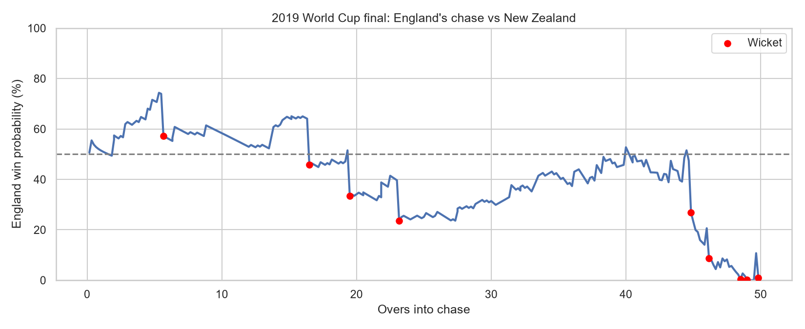
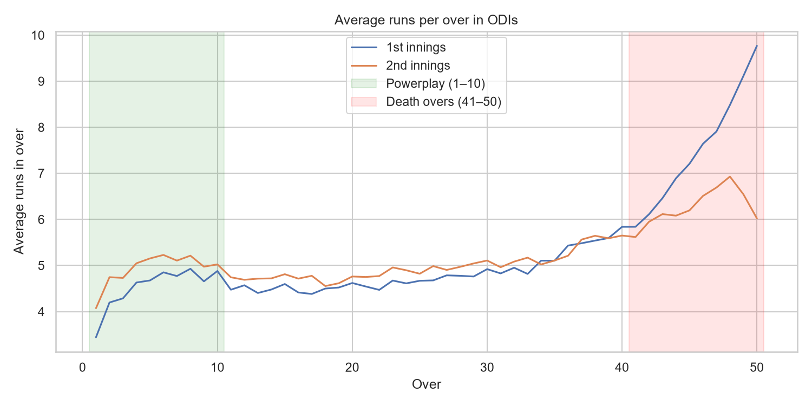
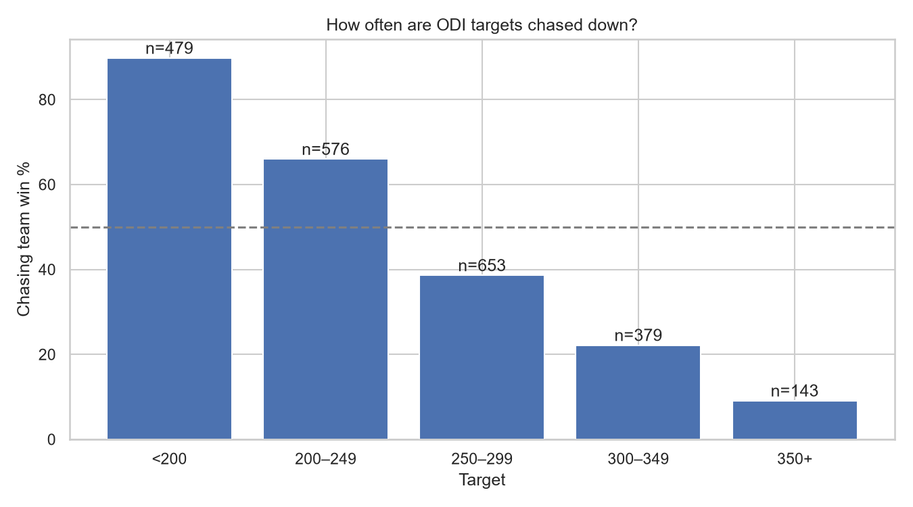
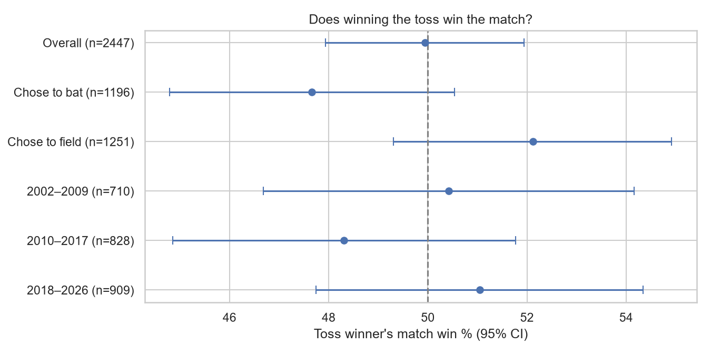
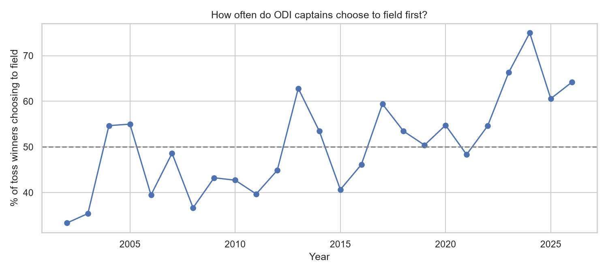
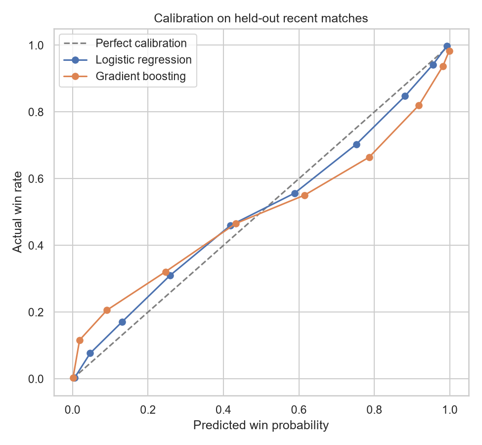

# ODI Cricket Analytics: Win Probability and the Toss

Ball-by-ball analysis of men's One Day Internationals (2002–2026) using open data from [Cricsheet](https://cricsheet.org). The project has three parts:

1. **Exploratory analysis** of how ODI innings are scored and how often targets are chased down.
2. **A hypothesis test** of whether winning the toss helps a team win the match.
3. **A win-probability model** that estimates, ball by ball, the chasing team's chance of winning.



## Key results

| Question | Result |
|---|---|
| Can match state predict a chase's outcome? | Yes. On the 447 most recent matches (held out from training), logistic regression achieved **ROC AUC 0.897** and **Brier score 0.132**, against 0.500 and 0.250 for a naive baseline. |
| Does winning the toss help? | No meaningful effect. Toss winners won **49.9%** of 2,447 decisive matches (95% CI 47.9–51.9%, p = 0.97). |
| How hard are big chases? | Chase success falls from about **90%** for targets under 200 to about **9%** for targets of 350+. |

## Data

- **Source:** Cricsheet ball-by-ball ODI data in JSON format ([downloads page](https://cricsheet.org/downloads/)).
- **Scale:** 3,187 match files parsed (1.69 million deliveries) with zero parsing errors; 2,576 men's ODIs retained.
- **Clean analysis set:** for scoring and modeling, matches with a decisive result, a 50-over limit and no DLS adjustment (2,230 matches). Rain-affected games follow different scoring patterns and would distort the results.

The raw data is not stored in this repository. Download the ODI JSON zip from Cricsheet and unzip it into `data/`.

## Project structure

```
├── notebooks/
│   ├── 01_parse_data.ipynb          # JSON → match-level and ball-level tables
│   ├── 02_eda.ipynb                 # scoring patterns and chase success
│   ├── 03_toss_hypothesis.ipynb     # binomial and chi-square tests
│   └── 04_win_probability.ipynb     # feature engineering, models, evaluation
├── figures/                         # charts used in this README
├── models/                          # saved win-probability model
└── data/                            # raw and processed data (not tracked)
```

## 1. Exploratory analysis



- ODI innings follow a clear three-phase shape: a quick powerplay, a slower middle phase, and sharp acceleration in overs 41–50, when first-innings scoring approaches 10 runs per over.
- Second-innings scoring appears to *fall* in the final overs. This is a selection effect rather than worse batting: comfortable chases finish early and drop out of the data, so the chases still running in overs 48–50 are disproportionately tight or collapsing ones.
- First-innings totals show no steady long-term rise. They peaked around 2015, and recent years have lower medians with a wider spread, possibly reflecting more ODIs between Associate nations. This drift is one reason the model is tested on the most recent matches.



Across the clean set, the chasing side won 52.0% of matches, but success depends heavily on the target.

## 2. Does winning the toss help?



**Method.** Each decisive match is a yes/no trial ("did the toss winner win?"), tested against a 50% null hypothesis with an exact binomial test and 95% confidence intervals. Rain-affected matches are included because the toss precedes any rain. A chi-square test compares the two toss decisions, and a Bonferroni correction accounts for running 7 tests.

**Findings.**

- **No overall effect:** 49.9% (95% CI 47.9–51.9%, p = 0.97). Any true toss advantage is at most about 2 percentage points.
- **Bat vs. field:** toss winners who chose to field won 52.1%, compared with 47.7% for those who chose to bat (χ² p = 0.030). This does not pass the Bonferroni threshold (p < 0.007), so it is suggestive rather than conclusive.
- **No era shows an effect;** all three era-level intervals include 50%.
- **Captains' choices have shifted anyway:** the share of toss winners choosing to field rose from roughly 35–45% in the 2000s to 60–75% recently, consistent with the small chasing advantage seen in the data.

Toss decisions are not random (a captain may bat first *because* of the conditions), so the bat-versus-field comparison should not be read as purely causal.



## 3. Win-probability model

**Setup.** Each live ball of a second innings is one example describing the match state. The label is whether that chase ultimately succeeded.

| Feature | Meaning |
|---|---|
| `runs_needed` | target minus runs scored so far |
| `balls_left` | legal deliveries remaining |
| `wickets_left` | 10 minus wickets fallen |
| `target` | first-innings total + 1 |
| `crr` | current run rate |
| `rrr` | required run rate (capped at 36) |

**Avoiding leakage.**

- **Split by match:** every ball in a match shares one outcome, so no match appears in both the training and test sets.
- **Split by time:** models are trained on the oldest 80% of matches (1,783 matches, 458,935 states, up to August 2022) and tested on the newest 20% (447 matches, 109,841 states), mirroring real use.
- **Terminal states removed:** states where the chase was already won or lost are dropped, since they are trivially predictable and would inflate scores.

**Models.** A logistic regression baseline, and gradient boosting with monotonic constraints (more runs needed always lowers win probability; more balls or wickets always raise it).

**Results on held-out recent matches:**

| Model | Log loss | Brier | ROC AUC |
|---|---|---|---|
| Naive baseline (training win rate) | 0.693 | 0.250 | 0.500 |
| **Logistic regression** | **0.402** | **0.132** | **0.897** |
| Gradient boosting | 0.467 | 0.148 | 0.878 |



The simpler model performed better. The calibration plot shows that gradient boosting is **overconfident at the extremes**: when it predicts about 2% or 10%, chasers in the recent test period actually won around 12% and 21% of the time, and its high-probability predictions are similarly too high. A likely explanation is that the boosted trees learned sharp patterns from the older training period that did not hold up after the cutoff, while logistic regression's smooth curve generalized better. Logistic regression is therefore the final model.

**Sanity check on coefficients.** On standardized features, the logistic regression's largest effects are required run rate (−2.25), runs needed (−2.21) and wickets left (+1.72), all in the expected direction. The positive weight on `target` (+0.66) is also plausible: with runs needed held fixed, a higher target means the chasers have already scored more, which usually indicates good batting conditions. Because runs needed, balls left and required run rate are related, individual coefficients should be read as a sanity check rather than as precise effect sizes.

**Case study: the 2019 World Cup final.** The match ended in a tie, and only decisive results were used for training, so the model never saw it. England's estimated chance peaked around 74% early in the chase, fell to about 23% after the fourth wicket in the 23rd over, climbed back to roughly 50% during the Stokes–Buttler partnership, and then dropped steeply after Buttler's dismissal in the 45th over, with a brief spike in the final over. In the closing overs the model gave England about a 1% chance of winning outright. The tie is consistent with that: the model predicts an outright win, and England did not win outright. A single match cannot validate a probabilistic model either way; the calibration plot above is the real test.

## Using the model

Notebook 04 includes a `win_probability()` helper that returns the chasing team's win probability for any match situation. Overs use cricket notation, so 32.4 means 32 overs and 4 balls.

```python
win_probability(target=300, score=180, wickets=4, overs=35.0)
```

The trained model is saved at `models/win_prob_logreg.joblib` and can be loaded with `joblib.load()`.

## Limitations

- **No team strength, venue or conditions.** The model sees only the match state, so it treats every team as equal. A strong side chasing against a weak attack gets the same probability as the reverse.
- **Rain-affected and reduced-overs matches are excluded** from the model and the scoring analysis.
- **Ball-level evaluation weights long chases more heavily,** and states within the same match are correlated, so metrics are not based on independent observations.
- **Possible distribution shift** in recent years (for example, a changing mix of Full Member and Associate matches) affects both the EDA trends and model performance.

## Possible extensions

- Add a team-strength rating (such as Elo) and venue effects.
- Model the first innings to estimate win probability from the very first ball.
- Serve the model through a small interactive app.

## Reproducing the analysis

```bash
python -m venv venv
venv\Scripts\activate            # Windows (macOS/Linux: source venv/bin/activate)
pip install pandas numpy matplotlib seaborn scipy scikit-learn lightgbm notebook
jupyter notebook
```

Download the ODI JSON zip from Cricsheet, unzip it into `data/`, then run the notebooks in order (01 → 04).

## Data credit

Ball-by-ball data from [Cricsheet](https://cricsheet.org), maintained by Stephen Rushe.
